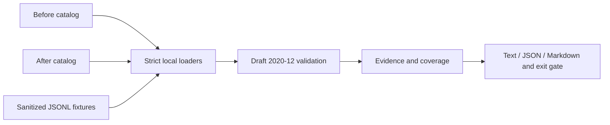

# Toolwitness

**Which saved MCP calls will this schema change break?**

[](https://github.com/Nithinfgs/toolwitness/actions/workflows/ci.yml)
[](LICENSE)
[](pyproject.toml)

Toolwitness compares sanitized call fixtures against two exported MCP tool catalogs.
It gives reviewers concrete regression evidence, JSON pointers to failing constraints,
and a list of contracts that still need examples. Everything runs locally. It never
connects to a server or executes a tool.

```text
"search-large-page" / "search" [input]: regression
  maximum at "/limit" (schema "/properties/limit/maximum")
"search-retired-mode" / "search" [input]: regression
  enum at "/mode" (schema "/properties/mode/enum")
```

A schema diff says something changed. A witness says **this existing example no longer
passes**. Neither is proof of runtime behavior or universal compatibility.

## Features

- Validate before and after with JSON Schema Draft 2020-12, including local references,
  nested objects, conditionals, arrays and composition.
- Separate regressions from fixtures that were already invalid in the baseline.
- Identify removed tools, newly admitted examples and metadata changes.
- Check historical structured outputs separately from request arguments.
- Surface tools without baseline-valid input coverage and outputs without comparable coverage.
- Emit deterministic text, JSON or Markdown reports; choose the CI failure threshold.
- Keep argument/output values out of reports; refuse external schema references.

## Install and quick start

Requires Python 3.11+ and Git. No API keys, server or environment variables are needed.
The package is installed from this repository; it is not published to PyPI.

```sh
git clone https://github.com/Nithinfgs/toolwitness.git
cd toolwitness
python3 -m venv .venv
. .venv/bin/activate
python -m pip install .
toolwitness examples/before.json examples/after.json examples/calls.jsonl
```

On Windows, activate with `.venv\Scripts\Activate.ps1` in PowerShell.
The intentionally breaking example exits **1**. For an informational demo:

```sh
toolwitness examples/before.json examples/after.json examples/calls.jsonl --fail-on none
# A baseline self-comparison:
toolwitness examples/before.json examples/before.json examples/calls.jsonl
# Machine-readable evidence:
toolwitness examples/before.json examples/after.json examples/calls.jsonl --format json --fail-on none > report.json
# Pull-request-ready report:
toolwitness examples/before.json examples/after.json examples/calls.jsonl --format markdown --fail-on none > report.md
```

See [the complete generated demo](docs/DEMO.txt).

## Bring your own fixtures

Export the **complete** `tools/list` result from your existing authorized client or server tests.
Either `{"tools":[...]}` or a JSON-RPC envelope `{"result":{"tools":[...]}}` works.
Combine paginated responses before use; `nextCursor` is rejected to avoid false removals.
Compare one server's catalog at a time. Names must be unique.

Write one sanitized case per line:

```json
{"id":"search-small-page","tool":"search","arguments":{"query":"docs","limit":5,"mode":"brief"},"output":{"count":2}}
```

`id`, `tool` and object-valued `arguments` are required. `output` is optional and represents
**structured output data**, not the MCP `content` envelope. IDs must be unique.
Blank lines are allowed; unknown fields and duplicate JSON keys are rejected.
Fixtures are deliberately explicit: raw session logs are not automatically imported.

Store fixtures alongside contract tests and capture examples for every meaningful branch,
including boundaries and optional fields. Sanitize secrets and personal data before saving.
Reports omit values, but identifiers and JSON pointer property names can still be sensitive.

## Interpreting results

| Status | Meaning |
|---|---|
| `accepted` | This example validates against both schemas. |
| `regression` | Baseline-valid arguments fail the candidate schema. |
| `tool_removed` | A baseline-valid input targets a removed tool. |
| `baseline_invalid` | Example already fails its old schema; not regression evidence. |
| `baseline_unknown` | Fixture tool does not exist in the old catalog. |
| `newly_admitted` | Previously invalid arguments now pass. |
| `historical_output_rejected` | An old-valid saved output fails the new output schema. |
| `output_unverified` | One side lacks an output schema. |

Historical output rejection is a review signal; it does **not** show that a new server
will return invalid data. A removed tool fails the default gate even without fixtures.
An added tool or any schema/metadata change requires review, even when examples pass.
Tools without baseline-valid examples remain coverage gaps. Output coverage requires
an old-valid output and schemas on both sides; input and output coverage are independent.

| `--fail-on` | Exit 1 when |
|---|---|
| `regression` (default) | Input regression, removed tool, or historical output rejection. |
| `review` | Any of the above, catalog change, coverage gap, or invalid/unverified fixture. |
| `none` | Never for findings; input errors still exit 2. |

Exit 0 means the selected gate passed. Exit 2 means bad input or evaluation error.
A report with `no_observed_regressions` covers only the supplied examples.
`newly_admitted` implies a change requiring review, but does not establish unsafe widening.

## Architecture and configuration



Python + `argparse` handle the CLI; `jsonschema` and `referencing` implement schema evaluation.
`inputs.py` bounds and validates files, `schema.py` applies reference policy,
`engine.py` classifies evidence, and `report.py` renders it. No database or background process.
Configuration is exclusively CLI flags; see `toolwitness --help`.

## CI and development

```sh
python -m pip install -e '.[dev]'
pytest --cov=toolwitness --cov-report=term-missing
ruff check .
ruff format --check .
mypy src
python -m build
pip-audit
```

Development dependencies resolved for the verified release are recorded in
[requirements-dev.lock](requirements-dev.lock); install that file to reproduce tool versions.
CI tests Python 3.11 and 3.14 on Linux and Python 3.12 on Windows. Dependency auditing is
separate from tests and may need network access. See [validation evidence](docs/VALIDATION.md).

Add a repository-specific gate after installation:

```yaml
- name: Check saved MCP contracts
  run: toolwitness contracts/before.json contracts/after.json contracts/calls.jsonl --fail-on review
```

## Limits and security model

- Example replay is not full JSON Schema containment, fuzzing, authorization analysis,
  transport testing, behavioral validation or a tool-poisoning detector.
- Only Draft 2020-12 (explicitly declared or assumed) is supported. `format` remains an
  annotation, not an assertion. Unknown extension keywords retain JSON Schema semantics
  and are ignored by validation; their changes still show up as schema changes.
- References must be local fragments (`#...`). `$id`, dynamic references and external
  references are rejected. Broken local references fail evaluation when reached.
- Files are limited to 10 MiB, nesting to 80 levels, fixtures to 10,000.
  These limits are not a sandbox: adversarial regular expressions or recursive schemas
  can consume CPU. Use reviewed schemas; isolate untrusted inputs with OS resource limits.
- No automatic collection, network access, tool execution or redaction of input files.
  The CLI reads local files and writes reports to stdout. Dependencies are needed at install time.

## Roadmap

1. Safe fixture import adapters with an explicit redaction preview.
2. Branch/boundary coverage suggestions for under-tested schemas.
3. Consumer-side output contracts for checking new producer samples against old clients.
4. Multi-server manifests with qualified tool identities.
5. Optional generated witnesses, kept separate from observed fixtures.

[Research and selection](docs/RESEARCH.md) explains the scope and competitive landscape.
See [CONTRIBUTING.md](CONTRIBUTING.md) to contribute and [SECURITY.md](SECURITY.md) for reporting.
Original implementation; distributed under the [MIT license](LICENSE).
